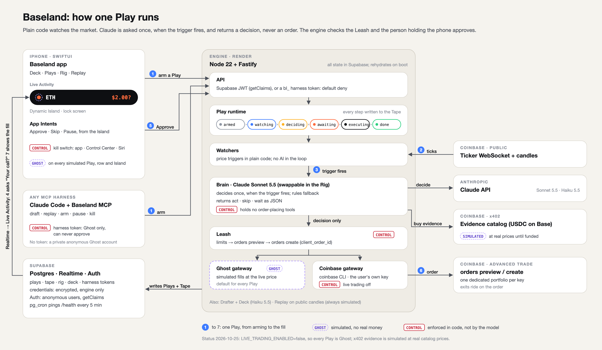

# Architecture

How Baseland is put together, why, and what it cannot do. This is also the
basis of the "Architecture" section of the hackathon submission.

Status: **all phases built** (2026-10-25): engine (Play runtime, Claude
Brain, drafting, Deck, Rig, Replay) deployed to Render by CI; iPhone app
verified in the simulator, including approval from the Dynamic Island and
the lock screen; the Baseland MCP and Claude Code skill. **One real trade
ran:** a live Play bought $2.97 of ETH, approved from the Dynamic Island,
filled on Coinbase with exits attached (`features/phase-04-live-money.md`).
Live trading is switched off again. Real x402 evidence is built but no
payment has succeeded yet (Coinbase rejected both attempts; nothing was
charged), so evidence stays simulated. Where this file and the code
disagree, the code wins and this file is wrong — report it.

---

## Components



How one Play runs, with every control where it sits; the submission figure
(source `diagrams/architecture.svg`, drawn by `diagrams/architecture.py`).
The sketch below is the component inventory.

```
┌──────────────────────── iPhone ─────────────────────────┐
│ Baseland app (SwiftUI)                                   │
│  ├─ Island (Basic): Play Deck, chip editor, Play detail  │
│  ├─ Rig (Advanced): Brain/Senses/Instincts/Hands/Leash,  │
│  │   Account, Replay, Cartridges, Tape                   │
│  ├─ LiveActivityManager: starts/updates the Live Activity│
│  └─ Realtime subscriber (Supabase) ──┐                   │
│ BaselandWidgets (extension)          │                   │
│  ├─ Live Activity + Dynamic Island   │                   │
│  └─ Control Center kill switch       │                   │
│ App Intents: Approve / Skip / Pause / Kill-all / Siri    │
└──────────────┬───────────────────────┼───────────────────┘
               │ HTTPS (Supabase JWT)  │ WebSocket (Realtime)
               ▼                       │
┌──────── Baseland Engine (Render) ────┼───────────────────┐
│ Fastify API ── auth: verify Supabase JWT (getClaims)     │
│ Play runtime: state machine, scheduler, rehydrate on boot│
│ Watchers: Coinbase public WebSocket ticker (no AI)       │
│ Decision step: Brain (Claude) + evidence tools ──► x402  │
│ Leash: limits check → orders preview → orders create     │
│ Coinbase gateway: `coinbase` CLI, per-user key via env   │
│ Ghost gateway: same interface, simulated fills           │
└──────────────┬───────────────────────┬───────────────────┘
               ▼                       ▼
   Supabase (Postgres + Auth +   Coinbase Advanced Trade API
   Realtime): plays, tape,       + x402 catalog (USDC on Base)
   rig, encrypted credentials

Baseland MCP (stdio, packages/mcp) ──► Engine API (harness token)
  so Claude Code / other harnesses can create, replay and stop Ghost Plays
```

## Key decisions and why

### LLM proposes, engine disposes
The model never holds order-placing tools. Its tools are read-only market data
and budgeted x402 evidence purchases. It returns a structured decision
(`act` / `skip` / `wait`, size within bounds, one-line reason). The engine then
checks the Leash, previews, and places the order itself. A prompt-injected or
confused model can at worst recommend something the Leash then rejects.

### AI only at decision points
Watching a price for six hours with an LLM in the loop is slow, expensive and
non-deterministic. Watchers are plain code on Coinbase's public ticker
WebSocket. The model runs when a trigger fires, when a sentence is parsed into
a Play, and when the Deck is generated.

### Coinbase CLI, not the hosted MCP
`agents.coinbase.com/mcp` uses Coinbase OAuth and only works in allowlisted
harnesses (ChatGPT, Claude, Grok, Muse, Perplexity, Codex). A custom app
cannot use it. Coinbase's documented route for custom harnesses is the
`@coinbase/coinbase-cli` package with a CDP API key. The engine runs it as a
child process with JSON output, passing each user's key through
`COINBASE_KEY_ID` / `COINBASE_KEY_SECRET` env vars for that process only.

Relevant CLI facts (v0.0.10, read from the package on 2026-10-24):
- Every command prints JSON to stdout; errors JSON to stderr, exit 1.
- `--dry-run` assembles a request without sending it.
- `coinbase x402 resources` (free discovery) and `coinbase x402 fetch`
  (pay + fetch, `max_amount` in atomic USDC) work with an API key.
- **Each CDP key is scoped to one portfolio.**
- `coinbase mcp` exposes the same API as a local stdio MCP server.

### Supabase Realtime instead of Apple push (for now)
There is no paid Apple Developer account, so no APNs: no push-to-start and no
remote Live Activity updates. The app subscribes to Supabase Realtime on its
Plays and Tape rows and updates the Live Activity locally. While a Play is
live, a background keep-alive holds the app open so updates keep flowing on
the lock screen. That keep-alive is **hackathon-only** (would fail App Review)
— see `production-checklist.md`. The APNs path is designed but not built.

### Hosting: Render free web service + keep-alive ping
Free, Docker-capable, long-running Node. Free services sleep after 15 minutes
without *inbound* traffic (outbound WebSockets don't count), so a Supabase
`pg_cron` + `pg_net` job (`keep-engine-awake`) calls `/health` every 5
minutes. No third-party pinger is needed. 750 free hours/month covers one
service running 24/7. All state is in Supabase, so a restart only re-arms
Plays from the database; nothing is lost.

Deploys come from GitHub Actions (`.github/workflows/engine.yml`): a push to
`main` that touches the engine runs typecheck and tests, and only then calls
the service's Render deploy hook. Render's own auto-deploy is off because the
service was created from the public repo URL, which Render cannot watch.

### Ghost is a gateway, not a flag sprinkled everywhere
The Play runtime talks to a `TradingGateway` interface. `CoinbaseGateway`
places real orders; `GhostGateway` fills simulated orders at the current
price. A Play's mode picks the gateway once. Every Tape event written through
`GhostGateway` carries `simulated: true`, and every client renders that.

### Exits: Coinbase holds live ones, the engine watches Ghost ones
A live entry BUY with a take-profit or stop-loss sends them **on the order
itself** (`attached_take_profit_price` / `attached_stop_loss_price` on
`orders create`, priced from the preview). Coinbase then enforces the exits
even if the engine is asleep or redeploying, and the Play ends `done` with
"Exits held by Coinbase". A Ghost Play has no exchange to hold its exits, so
the engine keeps it `watching` in an exit phase and sells the whole position
itself when a level is hit. Exits are pre-approved when a Play is armed; the
Leash still checks that an exit only sells what the Play bought.

### Live trading is off until the user switches it on
`LIVE_TRADING_ENABLED` (default `false`) gates every live Play at creation,
and `LIVE_MAX_ORDER_USD` (default $10) caps any single live order whatever a
cartridge says. A live order is placed only after Coinbase previews it, with
a deterministic `client_order_id` written to the Tape first, so a retry or a
restart can never create a second order.

### The Rig is applied at decision time, not at arming
Each user's Rig (`profiles.rig`, schema in `@baseland/play-schema`) is read
whenever a Play decides or orders, so an edit affects running Plays from
their next step:
- **Brain:** model and effort. The engine caches one Brain per combination,
  always wrapped in the rules fallback.
- **Senses:** a Play may only buy from Senses that are both in its
  cartridge *and* enabled in the Rig.
- **Instincts:** the user's own wording replaces the built-in text in the
  Brain's prompt.
- **Hands:** entries outside the Rig's assets are refused by the Leash
  check (exits always pass).
- **Leash:** the Rig's caps are a minimum taken over every Play's own Leash.

Drafts and Deck cards are built inside the Rig too (assets, Senses, amounts
clamped, approval policy). The Rig is advice-free configuration: it never
loosens a cartridge's limits, only tightens them.

### Replay is a separate, deterministic simulator
`POST /v1/replay` runs a cartridge over Coinbase's public candles, armed at
the start of the chosen range and watching the whole range. It assumes the
agent acts on the first trigger (no model call, so it's free and
repeatable), fills at the trigger level with the 0.9% fee, and exits at the
take-profit or stop-loss level (stop first when both fall in one candle).
It shares the trigger and exit math with the live runtime (`triggers.ts`)
but never touches the store or a gateway, and every result is labelled
simulated.

### Harnesses get a narrow token, never the app's session
The Baseland MCP must act as the phone's user, so that a Play created in
Claude Code appears on that user's Island. It doesn't reuse the app's
Supabase session: a refresh token rotates and would give a harness
everything the app can do. Instead the app mints a **harness token**
(`POST /v1/harness`, `bl_…`). It is shown once, masked on screen, and only
its SHA-256 is stored (`harness_tokens`). There is one per user; minting
again or Disconnect revokes it. In the engine it is **default deny**: a
`bl_` token opens only routes marked `config: { harness: true }` (create,
read, pause / resume / skip / kill, kill all, draft, preview, replay,
`/v1/me`) and gets 403 everywhere else. It can create **Ghost Plays only**
and can **never approve**, so a harness can author and stop Plays but cannot
spend money: the person holding the phone approves. Without a token, the MCP
signs in anonymously with the public key, which gives a private Ghost
account for trying Baseland without the app.

## Data model (Supabase)

| Table | Holds | Client access |
| --- | --- | --- |
| `profiles` | mode default, Rig config (brain, senses, instincts, hands, leash) | owner read/write |
| `credentials` | encrypted Coinbase key, portfolio UUID, last verified | **none** (engine only, service role) |
| `plays` | sentence chips, cartridge spec, mode, state, window, leash snapshot | owner read; writes via engine |
| `tape` | per-Play events: observe, evidence (+cost), decision, approval, order, fill, error, state; `simulated` flag | owner read |
| `deck_cards` | suggested Plays not yet armed | owner read |
| `harness_tokens` | SHA-256 of the user's harness token, created / last used | **none** (engine only, service role) |

Realtime is enabled on `plays` and `tape`, filtered by owner via RLS.

## Play cartridge (shape, to be finalized in code)

```jsonc
{
  "version": 1,
  "title": "ETH breakout",
  "sentence": "If [ETH] breaks [$4,000] on [volume] in the next [6h], buy [$5]...",
  "window": { "starts": "now", "ends": "+6h" },          // or an event id
  "trigger": { "kind": "price_cross", "product": "ETH-USDC", "above": 4000 },
  "evidence": { "senses": ["exa.news", "nansen.flows"], "budget_usdc": 0.10 },
  "decision": { "instinct": "momentum", "ask": "always" }, // or "above:25"
  "action": { "side": "BUY", "product": "ETH-USDC", "quote_usd": 5 },
  "exit": { "take_profit_pct": 4, "stop_loss_pct": 2 },
  "leash": { "max_order_usd": 10, "max_play_usd": 10, "max_evidence_usdc": 0.10 }
}
```

## Models

- **Decisions:** `claude-sonnet-5-5` by default; Opus 5.5 selectable in the
  Rig for harder calls. Structured output so decisions are machine-checked.
- **Sentence → chips and Deck generation:** `claude-haiku-5-5` (fast, cheap).
- The Brain is an interface; other providers are a backlog item.

## Known limitations

- **No APNs** → Live Activity updates only while the app is alive (keep-alive
  hack); no agent-started Live Activities.
- **Equities:** regular market hours only; Coinbase gives no previews or
  candles for them; the hackathon runs on a weekend → stock Plays are
  Ghost/Replay in the demo.
- **x402 budget is enforced by us,** not Coinbase (only a 5 USDC per-payment
  cap exists upstream). x402 payments are irreversible.
- **Coinbase has no fill webhooks**; the engine polls order status.
- **Render free tier sleeps** if the Supabase cron ping stops; a cold start
  takes about a minute and pauses watchers.
- **One portfolio per key.** Futures only work in the default portfolio, so
  futures Plays need a second key or are out of scope.
- **Judges cannot install the iOS app** without TestFlight (needs a paid
  account) → reuse path is the MCP/skill plus build-from-source instructions.
